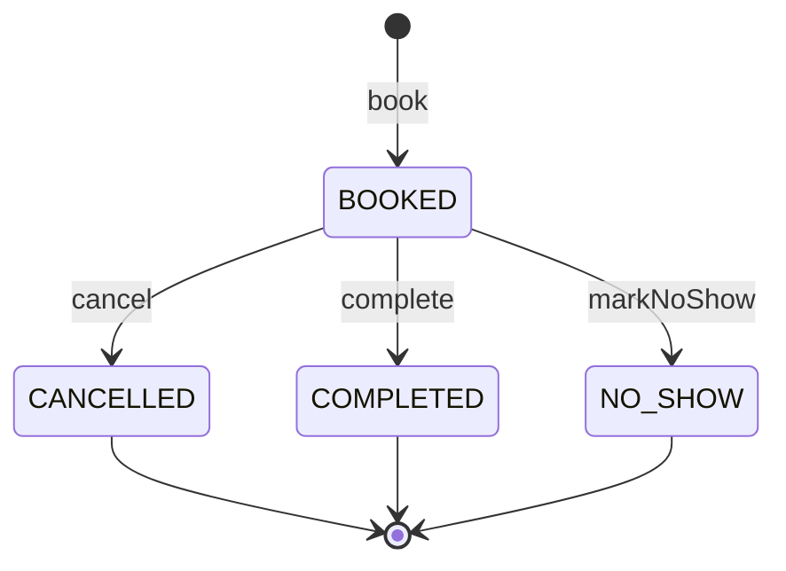
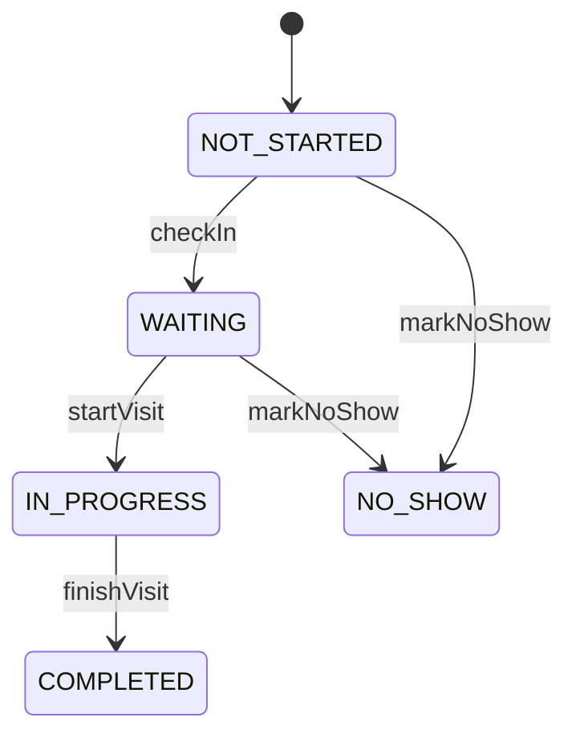
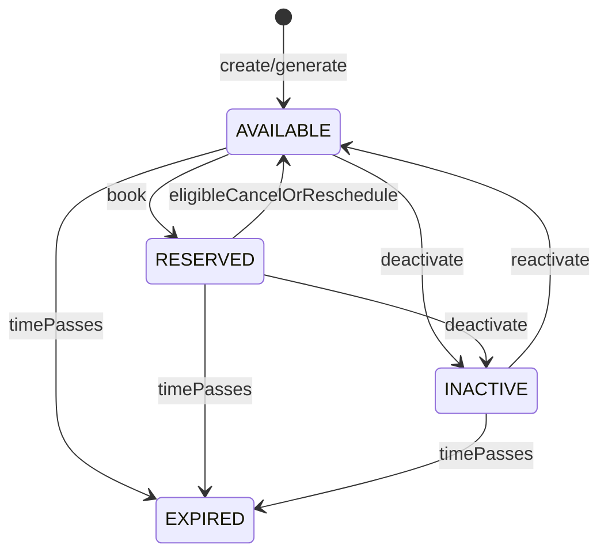

# Software Requirements Specification (SRS)

## سامانه نوبت‌دهی کلینیک پزشکی

**نسخه:** 1.0
**وضعیت:** Draft
**نوع سند:** Software Requirements Specification
**استاندارد مرجع:** ISO/IEC/IEEE 29148:2018
**دامنه:** سامانه مدیریت و رزرو نوبت کلینیک پزشکی

---

# 1. مقدمه

## 1.1 هدف سند

هدف این سند، تعریف دقیق و قابل‌راستی‌آزمایی نیازمندی‌های سامانه نوبت‌دهی کلینیک پزشکی است.

این سند به‌عنوان مرجع مشترک میان:

* Product Owner
* Business Analyst
* Software Architect
* Developers
* QA Engineers
* UI/UX Designers
* Project Manager
* Stakeholders

استفاده خواهد شد.

---

## 1.2 هدف محصول

سامانه باید امکان مدیریت پزشکان، برنامه کاری، زمان‌های قابل رزرو، بیماران و نوبت‌ها را فراهم کند.

بیمار باید بتواند پزشک موردنظر خود را پیدا کرده، زمان مناسب را مشاهده و نوبت خود را ثبت، مشاهده، لغو یا در صورت امکان جابه‌جا کند.

کلینیک نیز باید بتواند برنامه پزشکان، نوبت‌ها، ظرفیت‌ها و وضعیت مراجعه بیماران را مدیریت کند.

---

# 2. دامنه سیستم

## 2.1 داخل محدوده

سیستم شامل قابلیت‌های زیر است:

1. ثبت‌نام و ورود کاربران
2. مدیریت پروفایل بیمار
3. مدیریت پزشکان
4. مدیریت تخصص‌ها
5. مدیریت برنامه کاری پزشکان
6. تعریف Slotهای قابل رزرو
7. جستجوی پزشک
8. مشاهده زمان‌های آزاد
9. رزرو نوبت
10. جلوگیری از رزرو همزمان
11. لغو نوبت
12. تغییر زمان نوبت
13. مشاهده سوابق نوبت
14. مدیریت وضعیت نوبت
15. اطلاع‌رسانی
16. مدیریت کاربران توسط مدیر
17. گزارش‌گیری
18. ثبت Audit Log

---

## 2.2 خارج از محدوده نسخه اول

موارد زیر در MVP قرار ندارند:

* پرونده پزشکی کامل
* نسخه الکترونیکی
* پرداخت بیمه
* ارتباط ویدئویی با پزشک
* تشخیص بیماری
* سیستم مالی کامل کلینیک
* مدیریت چند کلینیک مستقل
* مدیریت داروخانه
* سیستم آزمایشگاه

---

# 3. ذی‌نفعان

| Stakeholder | نیاز اصلی                        |
| ----------- | -------------------------------- |
| بیمار       | رزرو سریع و مطمئن نوبت           |
| پزشک        | مشاهده و مدیریت برنامه کاری      |
| منشی        | مدیریت نوبت‌های بیماران          |
| مدیر کلینیک | مدیریت کل سیستم                  |
| مدیر سیستم  | مدیریت کاربران و تنظیمات         |
| تیم توسعه   | نیازمندی دقیق و قابل تست         |
| تیم QA      | معیارهای پذیرش و تست             |
| تیم معماری  | Constraints و Quality Attributes |

---

# 4. کاربران سیستم

## 4.1 Patient

بیمار می‌تواند:

* ثبت‌نام کند
* وارد سیستم شود
* پروفایل خود را مدیریت کند
* پزشک جستجو کند
* زمان‌های آزاد را مشاهده کند
* نوبت رزرو کند
* نوبت‌های خود را مشاهده کند
* نوبت را لغو کند
* نوبت را تغییر دهد

---

## 4.2 Doctor

پزشک می‌تواند:

* برنامه کاری خود را مشاهده کند
* زمان‌های کاری خود را مدیریت کند
* نوبت‌های خود را مشاهده کند
* وضعیت مراجعه بیمار را ثبت کند

---

## 4.3 Receptionist

منشی می‌تواند:

* بیماران را جستجو کند
* برای بیمار نوبت ثبت کند
* نوبت را لغو یا تغییر دهد
* لیست نوبت‌های روزانه را مشاهده کند
* وضعیت مراجعه بیمار را ثبت کند

---

## 4.4 Clinic Admin

مدیر کلینیک می‌تواند:

* پزشک ایجاد کند
* پزشک را غیرفعال کند
* تخصص‌ها را مدیریت کند
* برنامه کاری پزشکان را مدیریت کند
* گزارش‌ها را مشاهده کند
* کاربران را مدیریت کند

---

## 4.5 System Administrator

مدیر سیستم مسئول:

* مدیریت دسترسی‌ها
* تنظیمات سیستم
* مدیریت کاربران مدیریتی
* مشاهده Audit Log
* تنظیمات عمومی سیستم

است.

---

## 4.6 سیاست نقش‌ها و حدود دسترسی

قواعد MVP برای نقش‌ها:

* `Patient` فقط روی داده‌ها و نوبت‌های خودش عمل می‌کند.
* `Doctor` فقط روی schedule، slotها و appointmentهای منتسب به خودش عمل می‌کند.
* `Receptionist` عملیات روزمره رزرو، لغو، جابه‌جایی و مدیریت مراجعه را برای بیماران کلینیک انجام می‌دهد.
* `Clinic Admin` مالک عملیات کسب‌وکاری در سطح کلینیک است و تمام capabilityهای `Receptionist` را دارد.
* `System Admin` نقش فنی/امنیتی است و actor روزمره کسب‌وکاری برای رزرو و نوبت‌دهی محسوب نمی‌شود.

قواعد override:

* `Receptionist` و `Clinic Admin` می‌توانند خارج از `Cancellation Window` لغو یا جابه‌جایی انجام دهند.
* `Patient` چنین overrideای ندارد.
* overrideهای دستی باید audit شوند.

---

# 5. تعاریف

| اصطلاح             | تعریف                   |
| ------------------ | ----------------------- |
| Patient            | بیمار                   |
| Doctor             | پزشک                    |
| Appointment        | نوبت                    |
| Slot               | یک بازه زمانی قابل رزرو |
| Schedule           | برنامه کاری پزشک        |
| Specialty          | تخصص پزشک               |
| Receptionist       | منشی                    |
| Clinic Admin       | مدیر کلینیک             |
| Appointment Status | وضعیت نوبت              |
| Cancellation       | لغو نوبت                |
| Rescheduling       | تغییر زمان نوبت         |

---

# 6. فرضیات

1. هر پزشک دارای برنامه کاری مشخص است.
2. هر Slot متعلق به یک پزشک است.
3. یک Slot در حالت عادی فقط توسط یک بیمار قابل رزرو است.
4. بیمار می‌تواند چند نوبت در روز داشته باشد، مگر اینکه Business Rule دیگری تعریف شود.
5. نوبت پس از رزرو دارای شناسه یکتا خواهد بود.
6. سیستم باید زمان محلی کلینیک را به‌عنوان مبنای زمان‌بندی در نظر بگیرد.
7. اطلاعات بیماران محرمانه محسوب می‌شود.
8. تمام تغییرات حساس باید قابل Audit باشند.

---

# 7. محدودیت‌ها

1. سیستم باید تحت وب باشد.
2. Backend باید API محور باشد.
3. سیستم باید قابلیت توسعه در آینده را داشته باشد.
4. اطلاعات باید در یک پایگاه داده تراکنشی ذخیره شوند.
5. رزرو نوبت باید به‌صورت Atomic انجام شود.
6. سیستم نباید اجازه ایجاد دو نوبت معتبر برای یک Slot را بدهد.
7. اطلاعات حساس نباید در Logهای عادی ثبت شوند.
8. دسترسی کاربران باید مبتنی بر Role باشد.
9. ownership-based access برای بیمار و پزشک باید enforce شود.

---

# 8. Business Rules

## BR-001 — یکتایی رزرو

هر Slot فعال باید حداکثر یک نوبت فعال داشته باشد.

تعریف `Appointment فعال` در baseline فعلی:

* `BOOKED`
* `CONFIRMED` (در صورت فعال شدن این وضعیت در نسخه‌های بعدی)

نوبت‌های `CANCELLED`, `COMPLETED`, `NO_SHOW` فعال محسوب نمی‌شوند.

---

## BR-002 — رزرو همزمان

در صورت ارسال همزمان درخواست رزرو برای یک Slot، فقط یکی از درخواست‌ها باید موفق شود.

قواعد دقیق:

* درخواست برنده باید Appointment را با موفقیت ثبت کند.
* همه درخواست‌های بازنده باید با خطای `APPOINTMENT_SLOT_UNAVAILABLE` رد شوند.
* ایجاد دو Appointment فعال برای یک Slot تحت هیچ شرایطی مجاز نیست.
* این قاعده باید با invariant سطح پایگاه داده و transaction محلی enforce شود.

---

## BR-003 — رزرو Slot گذشته

Slotهای مربوط به زمان گذشته نباید قابل رزرو باشند.

تعریف دقیق:

* اگر `scheduledStart <= now` بر اساس timezone رسمی کلینیک باشد، Slot قابل رزرو نیست.

---

## BR-004 — پزشک غیرفعال

برای پزشک غیرفعال نباید امکان رزرو نوبت جدید وجود داشته باشد.

همچنین برای Slot غیرفعال نیز نباید امکان رزرو نوبت جدید وجود داشته باشد.

نتیجه:

* `Doctor Inactive` → رزرو جدید رد می‌شود.
* `Slot Inactive` → رزرو جدید رد می‌شود.
* `Past Slot` → رزرو جدید رد می‌شود.

---

## BR-005 — لغو نوبت

بیمار فقط تا مدت مشخصی قبل از زمان نوبت مجاز به لغو نوبت است.

مقدار نهایی برای MVP:

`Cancellation Window = 2 hours`

قواعد دقیق:

* زمان مرجع، `scheduledStart` در timezone رسمی کلینیک است.
* بیمار فقط وقتی مجاز به لغو است که حداقل ۲ ساعت تا زمان نوبت باقی مانده باشد.
* `Receptionist` و `Clinic Admin` می‌توانند خارج از این بازه نیز نوبت را لغو کنند.
* لغو باعث حذف تاریخچه Appointment نمی‌شود.

---

## BR-006 — تغییر نوبت

تغییر نوبت باید تنها به یک Slot آزاد دیگر امکان‌پذیر باشد.

قواعد دقیق:

* Slot جدید باید فعال، آینده، متعلق به پزشک فعال و بدون Appointment فعال باشد.
* عملیات Reschedule باید اتمیک باشد.
* در Failure، نوبت قبلی بدون تغییر باقی می‌ماند.
* بیمار فقط تا قبل از پایان `Cancellation Window` می‌تواند Reschedule انجام دهد.
* `Receptionist` و `Clinic Admin` می‌توانند خارج از `Cancellation Window` نیز Reschedule انجام دهند.

---

## BR-007 — Slot رزروشده

Slot دارای نوبت فعال نباید در نتایج زمان‌های آزاد نمایش داده شود.

همچنین Slot غیرفعال یا Slot گذشته نیز نباید در نتایج زمان‌های آزاد نمایش داده شود.

پس از لغو Appointment:

* اگر Slot هنوز آینده باشد و خود Slot و Doctor فعال باشند، Slot دوباره قابل رزرو می‌شود.
* اگر Slot غیرفعال شده باشد، یا پزشک غیرفعال شده باشد، یا زمان Slot گذشته باشد، Slot دوباره قابل رزرو نمی‌شود.

---

## BR-008 — نوبت‌های فعال بیمار

بیمار می‌تواند چند نوبت فعال داشته باشد، اما نمی‌تواند بیش از یک نوبت فعال با یک پزشک در یک روز تقویمی داشته باشد.

نتیجه:

* چند نوبت فعال برای پزشکان مختلف مجاز است.
* ایجاد نوبت فعال دوم برای همان پزشک در همان روز باید با خطای `PATIENT_ACTIVE_APPOINTMENT_EXISTS` رد شود.

---

## BR-009 — وضعیت نوبت

در baseline فعلی، `Appointment Status` و `Visit Status` دو مفهوم جدا هستند.

### Appointment Status (MVP)

* BOOKED
* CANCELLED
* COMPLETED
* NO_SHOW

### Visit Status

* NOT_STARTED
* WAITING
* IN_PROGRESS
* COMPLETED
* NO_SHOW

### Slot Status

* AVAILABLE
* RESERVED
* INACTIVE
* EXPIRED

`CONFIRMED` در baseline فعلی جزو وضعیت‌های MVP نیست و برای نسخه‌های آینده رزرو شده است.

---

# 9. Functional Requirements

## 9.1 مدیریت حساب کاربری

### FR-001 — ثبت‌نام بیمار

سیستم باید امکان ثبت‌نام بیمار با اطلاعات زیر را فراهم کند:

* نام
* نام خانوادگی
* شماره موبایل
* تاریخ تولد
* رمز عبور

شماره موبایل باید یکتا باشد.

---

### FR-002 — ورود

سیستم باید امکان ورود کاربر با شماره موبایل و رمز عبور را فراهم کند.

---

### FR-003 — خروج

سیستم باید امکان خروج کاربر از حساب را فراهم کند.

---

### FR-004 — بازیابی رمز عبور

سیستم باید امکان بازیابی رمز عبور را فراهم کند.

---

# 10. مدیریت پزشکان

### FR-005 — ایجاد پزشک

مدیر باید بتواند پزشک جدید ایجاد کند.

اطلاعات پزشک شامل:

* نام
* نام خانوادگی
* شماره نظام پزشکی
* تخصص
* وضعیت فعال/غیرفعال
* مدت زمان استاندارد هر نوبت

است.

---

### FR-006 — ویرایش پزشک

مدیر باید بتواند اطلاعات پزشک را ویرایش کند.

---

### FR-007 — غیرفعال کردن پزشک

مدیر باید بتواند پزشک را غیرفعال کند.

پس از غیرفعال شدن پزشک:

* نوبت‌های قبلی حفظ می‌شوند.
* نوبت‌های جدید امکان ثبت ندارند.

---

# 11. مدیریت تخصص‌ها

### FR-008

مدیر باید بتواند تخصص جدید ایجاد کند.

---

### FR-009

مدیر باید بتواند تخصص را ویرایش یا غیرفعال کند.

---

### FR-010

بیمار باید بتواند پزشکان را بر اساس تخصص جستجو کند.

---

# 12. مدیریت برنامه کاری

### FR-011 — تعریف Schedule

مدیر یا پزشک مجاز باید بتواند برنامه کاری پزشک را تعریف کند.

نمونه:

| Day      | Start |   End |
| -------- | ----: | ----: |
| Saturday | 09:00 | 13:00 |
| Monday   | 16:00 | 20:00 |

---

### FR-012 — تعطیلی

مدیر باید بتواند یک روز یا بازه زمانی را برای پزشک تعطیل کند.

---

### FR-013 — ایجاد Slot

سیستم باید بتواند بر اساس Schedule پزشک، Slot ایجاد کند.

مثلاً:

`09:00 - 09:20`

`09:20 - 09:40`

`09:40 - 10:00`

---

# 13. جستجوی پزشک

### FR-014

بیمار باید بتواند پزشک را بر اساس:

* نام
* تخصص
* تاریخ
* زمان

جستجو کند.

---

### FR-015

سیستم باید فقط پزشکان فعال را در جستجوی عمومی نمایش دهد.

---

# 14. مشاهده زمان‌های آزاد

### FR-016

بیمار باید بتواند زمان‌های آزاد پزشک را برای تاریخ مشخص مشاهده کند.

---

### FR-017

سیستم نباید Slotهای:

* گذشته
* رزروشده
* متعلق به پزشک غیرفعال

را به‌عنوان زمان آزاد نمایش دهد.

---

# 15. رزرو نوبت

### FR-018 — ایجاد رزرو

بیمار باید بتواند یک Slot آزاد را رزرو کند.

---

### FR-019 — ایجاد شناسه

پس از موفقیت رزرو، سیستم باید یک شناسه یکتا برای Appointment ایجاد کند.

---

### FR-020 — تأیید رزرو

سیستم باید اطلاعات رزرو را به کاربر نمایش دهد.

اطلاعات شامل:

* شماره نوبت
* پزشک
* تخصص
* تاریخ
* ساعت
* وضعیت

است.

---

### FR-021 — جلوگیری از رزرو تکراری

سیستم باید از ایجاد بیش از یک Appointment فعال برای یک Slot جلوگیری کند.

Implementation expectation for MVP:

* invariant باید در سطح database نیز enforce شود.

---

### FR-022 — رزرو همزمان

اگر دو کاربر به‌صورت همزمان یک Slot را رزرو کنند:

* حداکثر یک درخواست باید موفق شود.
* سایر درخواست‌ها باید با خطای `APPOINTMENT_SLOT_UNAVAILABLE` مواجه شوند.
* سیستم نباید دو Appointment فعال ایجاد کند.

---

# 16. لغو نوبت

### FR-023

بیمار باید بتواند نوبت خود را لغو کند، مشروط بر رعایت Cancellation Window.

---

### FR-024

پس از لغو:

* وضعیت Appointment باید `CANCELLED` شود.
* Slot فقط در صورتی باید مجدداً قابل رزرو شود که آینده باشد و خود Slot و Doctor فعال باشند.
* سابقه Appointment نباید حذف شود.

---

# 17. تغییر نوبت

### FR-025

بیمار باید بتواند نوبت خود را به Slot آزاد دیگری منتقل کند.

Slot جدید باید:

* فعال باشد
* آینده باشد
* متعلق به پزشک فعال باشد
* نوبت فعال دیگری نداشته باشد

---

### FR-026

در Reschedule باید اتمیک بودن عملیات حفظ شود.

یعنی سیستم نباید در شرایط خطا:

* نوبت قبلی را حذف کند
* ولی نوبت جدید ایجاد نشود.

همچنین بیمار فقط تا قبل از پایان `Cancellation Window` مجاز به Reschedule است؛ کارکنان داخلی مجاز می‌توانند خارج از این بازه نیز Reschedule انجام دهند.

---

# 18. مشاهده نوبت‌ها

### FR-027

بیمار باید بتواند نوبت‌های خود را مشاهده کند.

---

### FR-028

سیستم باید امکان مشاهده:

* نوبت‌های آینده
* نوبت‌های قبلی
* نوبت‌های لغوشده

را فراهم کند.

---

# 19. مدیریت نوبت توسط منشی

### FR-029

منشی باید بتواند برای بیمار نوبت ایجاد کند.

---

### FR-030

منشی باید بتواند نوبت را لغو کند.

---

### FR-031

منشی باید بتواند نوبت را تغییر دهد.

---

### FR-032

منشی باید بتواند نوبت‌های یک پزشک را برای یک روز مشاهده کند.

---

# 20. مدیریت مراجعه

### FR-033

منشی یا پزشک باید بتواند وضعیت مراجعه بیمار را ثبت کند.

وضعیت‌ها:

* WAITING
* IN_PROGRESS
* COMPLETED
* NO_SHOW

---

# 21. Notification

### FR-034

سیستم باید پس از رزرو موفق، Notification ایجاد کند.

---

### FR-035

سیستم باید در صورت لغو نوبت Notification ایجاد کند.

---

### FR-036

سیستم باید امکان ارسال Reminder قبل از زمان نوبت را داشته باشد.

کانال‌های قابل پشتیبانی:

* SMS
* Email
* Push Notification

---

# 22. گزارش‌گیری

### FR-037

مدیر باید بتواند گزارش نوبت‌ها را مشاهده کند.

فیلترها:

* پزشک
* تخصص
* تاریخ
* وضعیت

---

### FR-038

سیستم باید تعداد نوبت‌های:

* رزروشده
* لغوشده
* تکمیل‌شده
* عدم مراجعه

را گزارش کند.

---

# 23. Audit

### FR-039

سیستم باید عملیات حساس را ثبت کند.

نمونه:

* ایجاد پزشک
* غیرفعال کردن پزشک
* ایجاد نوبت
* لغو نوبت
* تغییر نوبت
* تغییر Schedule

---

# 24. Exception Requirements

## EX-001 — Slot قبلاً رزرو شده

اگر Slot در زمان درخواست رزرو قبلاً رزرو شده باشد، سیستم باید درخواست را رد کند.

---

## EX-002 — Slot منقضی شده

اگر زمان Slot گذشته باشد، سیستم باید رزرو را رد کند.

---

## EX-003 — پزشک غیرفعال

اگر پزشک غیرفعال شده باشد، سیستم نباید رزرو جدید ایجاد کند.

---

## EX-004 — کاربر غیرمجاز

اگر کاربر مجوز انجام عملیات را نداشته باشد، سیستم باید درخواست را رد کند.

---

## EX-005 — Slot نامعتبر

اگر Slot وجود نداشته باشد، سیستم باید خطای مناسب برگرداند.

---

## EX-006 — خطای همزمانی

در صورت Race Condition هنگام رزرو، فقط یک تراکنش باید موفق شود.

---

# 25. Non-Functional Requirements

## 25.1 Performance

### NFR-PERF-001

95 درصد درخواست‌های API عادی باید در کمتر از **300ms** پاسخ داده شوند.

---

### NFR-PERF-002

99 درصد درخواست‌های API عادی باید در کمتر از **500ms** پاسخ داده شوند.

---

### NFR-PERF-003

عملیات رزرو نوبت باید در شرایط عادی در کمتر از **500ms** پاسخ دهد.

---

### NFR-PERF-004

سیستم باید حداقل **100 درخواست رزرو همزمان** را پشتیبانی کند.

---

# 26. Availability

### NFR-AVL-001

سیستم باید حداقل **99.5%** Availability ماهانه داشته باشد.

---

### NFR-AVL-002

خرابی یک درخواست نباید باعث از دست رفتن اطلاعات رزروهای قبلی شود.

---

# 27. Reliability

### NFR-REL-001

سیستم نباید در هیچ شرایطی بیش از یک Appointment فعال برای یک Slot ایجاد کند.

---

### NFR-REL-002

عملیات رزرو باید Atomic باشد.

---

### NFR-REL-003

در صورت Failure در عملیات رزرو، داده ناقص نباید در سیستم باقی بماند.

---

# 28. Security

### NFR-SEC-001

تمام ارتباطات Client و Server باید از طریق HTTPS انجام شود.

---

### NFR-SEC-002

رمزهای عبور نباید به‌صورت Plain Text ذخیره شوند.

---

### NFR-SEC-003

سیستم باید Role-Based Access Control داشته باشد.

---

### NFR-SEC-004

بیمار نباید بتواند اطلاعات بیمار دیگر را مشاهده کند.

---

### NFR-SEC-005

کاربر باید فقط مجاز به مشاهده و تغییر منابع متعلق به خود باشد، مگر اینکه Role او دسترسی مدیریتی داشته باشد.

ماتریس تفصیلی نقش/مجوز در `docs/architecture/domain/access-control-matrix.md` ثبت شده است.

---

### NFR-SEC-006

اطلاعات حساس نباید در Application Log ثبت شوند.

---

# 29. Privacy

### NFR-PRIV-001

اطلاعات شخصی بیماران باید محرمانه نگهداری شود.

---

### NFR-PRIV-002

دسترسی به اطلاعات حساس باید قابل Audit باشد.

---

### NFR-PRIV-003

سیستم باید حداقل داده موردنیاز برای عملیات نوبت‌دهی را ذخیره کند.

---

# 30. Usability

### NFR-USE-001

کاربر باید بتواند از صفحه اصلی حداکثر در سه مرحله به لیست زمان‌های آزاد یک پزشک برسد.

---

### NFR-USE-002

فرآیند رزرو باید ساده و قابل فهم باشد.

---

### NFR-USE-003

خطاهای Business باید با پیام قابل فهم برای کاربر نمایش داده شوند.

---

# 31. Scalability

### NFR-SCAL-001

معماری سیستم باید امکان افزایش تعداد کاربران بدون تغییر اساسی در Domain Model را فراهم کند.

---

### NFR-SCAL-002

سیستم باید قابلیت Scale کردن Backend را داشته باشد.

---

### NFR-SCAL-003

طراحی باید امکان افزایش تعداد کلینیک‌ها در نسخه‌های آینده را محدود نکند.

---

# 32. Maintainability

### NFR-MAIN-001

کد باید Modular و قابل تست باشد.

---

### NFR-MAIN-002

Business Logic نباید به UI وابسته باشد.

---

### NFR-MAIN-003

APIها باید مستندسازی شوند.

---

### NFR-MAIN-004

Business Ruleهای مهم باید دارای Automated Test باشند.

---

# 33. Compatibility

### NFR-COMP-001

سیستم باید روی آخرین نسخه‌های رایج:

* Chrome
* Firefox
* Edge
* Safari

کار کند.

---

# 34. Accessibility

### NFR-ACC-001

رابط کاربری باید برای کاربران دارای محدودیت‌های دسترسی تا حد امکان قابل استفاده باشد.

---

# 35. External Interface Requirements

## 35.1 Web Application

سیستم باید یک رابط وب برای بیماران و کاربران مدیریتی ارائه کند.

---

## 35.2 REST API

Backend باید APIهای لازم برای:

* Authentication
* Doctors
* Specialties
* Schedules
* Slots
* Appointments
* Patients
* Notifications

را ارائه کند.

---

## 35.3 SMS Provider

سیستم باید قابلیت اتصال به یک SMS Provider خارجی را داشته باشد.

---

# 36. Data Requirements

## Patient

```text
Patient
---------
id
firstName
lastName
mobile
dateOfBirth
passwordHash
status
createdAt
updatedAt
```

---

## Doctor

```text
Doctor
---------
id
firstName
lastName
medicalLicenseNumber
specialtyId
appointmentDuration
status
createdAt
updatedAt
```

---

## Specialty

```text
Specialty
---------
id
name
description
status
```

---

## Schedule

```text
Schedule
---------
id
doctorId
dayOfWeek
startTime
endTime
status
```

---

## Slot

```text
Slot
---------
id
doctorId
startAt
endAt
status
```

---

## Appointment

```text
Appointment
-----------
id
slotId
patientId
status
createdAt
updatedAt
cancelledAt
```

---

# 37. Data Integrity Requirements

### DATA-001

شناسه هر Entity باید یکتا باشد.

### DATA-002

شماره موبایل بیمار باید Unique باشد.

### DATA-003

شماره نظام پزشکی پزشک باید Unique باشد.

### DATA-004

هر Slot باید متعلق به یک پزشک باشد.

### DATA-005

هر Appointment باید متعلق به یک Patient و یک Slot باشد.

### DATA-006

سیستم باید از ایجاد Appointment فعال تکراری برای یک Slot جلوگیری کند.

---

# 38. Use Cases

## UC-001 — رزرو نوبت

**Actor:** Patient

### Preconditions

* بیمار وارد سیستم شده است.
* پزشک فعال است.
* Slot موجود است.
* Slot در آینده قرار دارد.

### Main Flow

1. بیمار پزشک را انتخاب می‌کند.
2. تاریخ را انتخاب می‌کند.
3. سیستم Slotهای آزاد را نمایش می‌دهد.
4. بیمار Slot را انتخاب می‌کند.
5. سیستم درخواست رزرو را دریافت می‌کند.
6. سیستم اعتبارسنجی انجام می‌دهد.
7. سیستم Slot را رزرو می‌کند.
8. Appointment ایجاد می‌شود.
9. سیستم Confirmation را برمی‌گرداند.
10. Notification ایجاد می‌شود.

### Alternative Flow

اگر Slot قبلاً رزرو شده باشد:

1. سیستم درخواست را رد می‌کند.
2. وضعیت فعلی Slot را بررسی می‌کند.
3. پیام مناسب به کاربر نمایش داده می‌شود.

### Postcondition

یک Appointment فعال ایجاد شده است.

---

# 39. Use Case — لغو نوبت

**Actor:** Patient

### Main Flow

1. بیمار لیست نوبت‌ها را مشاهده می‌کند.
2. نوبت را انتخاب می‌کند.
3. گزینه لغو را انتخاب می‌کند.
4. سیستم Cancellation Policy را بررسی می‌کند.
5. وضعیت Appointment به `CANCELLED` تغییر می‌کند.
6. اگر guardهای availability برقرار باشند، Slot دوباره قابل رزرو می‌شود.
7. Notification ارسال می‌شود.

---

# 40. Use Case — تغییر نوبت

**Actor:** Patient

### Main Flow

1. بیمار نوبت موجود را انتخاب می‌کند.
2. گزینه Reschedule را انتخاب می‌کند.
3. سیستم Slotهای آزاد را نمایش می‌دهد.
4. بیمار Slot جدید را انتخاب می‌کند.
5. سیستم Slot جدید را اعتبارسنجی می‌کند.
6. سیستم تغییر را به‌صورت Atomic انجام می‌دهد.
7. Notification ارسال می‌شود.

---

# 41. State Machines

## 41.1 Appointment State Machine



| From | To | Trigger | Allowed Actors | Guards |
| --- | --- | --- | --- | --- |
| none | `BOOKED` | booking | `Patient`, `Receptionist`, `Clinic Admin` | Patient معتبر؛ Doctor فعال؛ Slot فعال و آینده؛ Slot بدون Appointment فعال؛ بیمار برای همان Doctor در همان روز Appointment فعال دیگری نداشته باشد |
| `BOOKED` | `CANCELLED` | cancellation | `Patient`, `Receptionist`, `Clinic Admin` | اگر actor بیمار است، `Cancellation Window` باید رعایت شود |
| `BOOKED` | `COMPLETED` | visit completion | `Doctor`, `Receptionist`, `Clinic Admin` | Appointment لغوشده نباشد |
| `BOOKED` | `NO_SHOW` | no-show marking | `Doctor`, `Receptionist`, `Clinic Admin` | زمان مراجعه رسیده یا گذشته باشد |

## 41.2 Visit State Machine



| From | To | Trigger | Allowed Actors | Guards |
| --- | --- | --- | --- | --- |
| none | `NOT_STARTED` | appointment creation | system | همزمان با ایجاد Appointment |
| `NOT_STARTED` | `WAITING` | check-in | `Receptionist`, `Doctor`, `Clinic Admin` | Appointment در وضعیت `BOOKED` باشد |
| `WAITING` | `IN_PROGRESS` | start visit | `Doctor`, `Receptionist`, `Clinic Admin` | Appointment در وضعیت `BOOKED` باشد |
| `IN_PROGRESS` | `COMPLETED` | finish visit | `Doctor`, `Receptionist`, `Clinic Admin` | خدمت پایان یافته باشد |
| `NOT_STARTED` | `NO_SHOW` | no-show marking | `Doctor`, `Receptionist`, `Clinic Admin`, system job | بیمار check-in نشده و زمان مراجعه گذشته باشد |
| `WAITING` | `NO_SHOW` | no-show marking | `Doctor`, `Receptionist`, `Clinic Admin` | policy کلینیک اجازه دهد |

Rule:

* `Visit Status = COMPLETED` باید `Appointment Status = COMPLETED` ایجاد کند.
* `Visit Status = NO_SHOW` باید `Appointment Status = NO_SHOW` ایجاد کند.

## 41.3 Slot State Machine



| From | To | Trigger | Allowed Actors | Guards |
| --- | --- | --- | --- | --- |
| none | `AVAILABLE` | slot creation/generation | `Clinic Admin`, authorized `Doctor`, system | Doctor فعال؛ هم‌پوشانی نداشته باشد؛ Slot آینده باشد |
| `AVAILABLE` | `RESERVED` | successful booking | system | Appointment فعال روی Slot ایجاد شده باشد |
| `AVAILABLE` | `INACTIVE` | deactivate slot | `Clinic Admin`, authorized `Doctor` | — |
| `AVAILABLE` | `EXPIRED` | time passes | system | `scheduledStart <= now` |
| `RESERVED` | `AVAILABLE` | cancellation/reschedule | system | Appointment فعال دیگر وجود نداشته باشد؛ Slot آینده و فعال باشد؛ Doctor فعال باشد |
| `RESERVED` | `INACTIVE` | deactivate slot | `Clinic Admin`, authorized `Doctor` | — |
| `RESERVED` | `EXPIRED` | time passes | system | `scheduledStart <= now` |
| `INACTIVE` | `AVAILABLE` | reactivate slot | `Clinic Admin`, authorized `Doctor` | Slot آینده باشد؛ Doctor فعال باشد؛ Appointment فعال نداشته باشد |
| `INACTIVE` | `EXPIRED` | time passes | system | `scheduledStart <= now` |

مرجع دامنه‌ای تفصیلی برای این state model در `docs/architecture/domain/state-machines.md` ثبت شده است.

---

# 42. Acceptance Criteria — رزرو

برای `FR-018`:

### AC-001

**Given** یک Slot آزاد وجود دارد
**When** بیمار Slot را رزرو می‌کند
**Then** Appointment باید ایجاد شود.

### AC-002

**Given** یک Slot قبلاً رزرو شده است
**When** بیمار دیگری همان Slot را رزرو می‌کند
**Then** درخواست باید رد شود.

### AC-003

**Given** دو درخواست همزمان برای یک Slot وجود دارد
**When** هر دو درخواست پردازش می‌شوند
**Then** حداکثر یکی باید موفق شود.

### AC-004

**Given** Slot مربوط به گذشته است
**When** بیمار درخواست رزرو ارسال می‌کند
**Then** سیستم باید درخواست را رد کند.

---

# 43. Acceptance Criteria — لغو

### AC-005

**Given** بیمار یک Appointment معتبر دارد
**When** قبل از Cancellation Window آن را لغو می‌کند
**Then** Appointment باید CANCELLED شود.

### AC-006

**Given** زمان نوبت کمتر از Cancellation Window فاصله دارد
**When** بیمار درخواست لغو می‌دهد
**Then** سیستم باید درخواست را رد کند.

### AC-006-A

**Given** زمان نوبت کمتر از Cancellation Window فاصله دارد
**When** منشی یا مدیر کلینیک درخواست لغو می‌دهد
**Then** سیستم می‌تواند لغو را انجام دهد و Appointment را `CANCELLED` کند.

---

# 44. Acceptance Criteria — Reschedule

### AC-007

اگر Slot جدید آزاد باشد، تغییر نوبت باید موفق شود.

### AC-008

اگر Slot جدید توسط کاربر دیگری رزرو شده باشد، تغییر نوبت نباید انجام شود.

### AC-009

در صورت Failure، Appointment قبلی نباید از بین برود.

### AC-010

**Given** یک Appointment برای Slot آینده لغو شده است
**And** Slot و Doctor همچنان فعال هستند
**When** وضعیت لغو ثبت می‌شود
**Then** Slot باید دوباره در نتایج زمان‌های آزاد ظاهر شود.

### AC-011

**Given** یک Appointment لغو شده است
**And** Slot غیرفعال است یا Doctor غیرفعال است یا زمان Slot گذشته است
**When** لغو ثبت می‌شود
**Then** Slot نباید دوباره قابل رزرو شود.

### AC-012

**Given** بیمار در همان روز تقویمی یک Appointment فعال با همان Doctor دارد
**When** تلاش می‌کند Appointment فعال دیگری برای همان Doctor ایجاد کند
**Then** سیستم باید درخواست را با خطای `PATIENT_ACTIVE_APPOINTMENT_EXISTS` رد کند.

### AC-013

**Given** Slot غیرفعال است یا زمان آن گذشته است
**When** بیمار یا پذیرش درخواست رزرو جدید می‌دهد
**Then** سیستم باید درخواست را رد کند.

---

# 45. Error Handling

نمونه Error Codeها:

| Code                         | Meaning               |
| ---------------------------- | --------------------- |
| APPOINTMENT_SLOT_NOT_FOUND   | Slot وجود ندارد       |
| APPOINTMENT_SLOT_UNAVAILABLE | Slot آزاد نیست        |
| APPOINTMENT_SLOT_INACTIVE    | Slot غیرفعال است      |
| APPOINTMENT_SLOT_EXPIRED     | Slot منقضی شده        |
| DOCTOR_INACTIVE              | پزشک غیرفعال است      |
| CANCELLATION_NOT_ALLOWED     | لغو مجاز نیست         |
| PATIENT_ACTIVE_APPOINTMENT_EXISTS | بیمار برای این پزشک در همان روز نوبت فعال دارد |
| RESCHEDULE_NOT_ALLOWED       | تغییر نوبت مجاز نیست  |
| UNAUTHORIZED                 | کاربر احراز هویت نشده |
| FORBIDDEN                    | دسترسی غیرمجاز        |

---

# 46. Observability

سیستم باید موارد زیر را قابل مشاهده کند:

* تعداد درخواست‌ها
* Response Time
* Error Rate
* تعداد رزروها
* تعداد رزروهای ناموفق
* تعداد Conflictهای رزرو
* تعداد لغوها
* تعداد No-Showها

---

# 47. Audit Requirements

برای عملیات حساس حداقل اطلاعات زیر ثبت شود:

```text
AuditLog
--------
id
actorId
action
entityType
entityId
timestamp
result
ipAddress
```

اطلاعات حساس بیمار نباید مستقیماً در Audit Log ذخیره شود.

---

# 48. Requirement Priorities

| Priority | Meaning            |
| -------- | ------------------ |
| MUST     | برای MVP ضروری     |
| SHOULD   | مهم ولی قابل تعویق |
| COULD    | قابلیت تکمیلی      |
| WON'T    | خارج از MVP        |

### MVP — MUST

* Authentication
* Patient Management
* Doctor Management
* Specialty Management
* Schedule Management
* Slot Management
* Search
* Appointment Booking
* Concurrent Booking Protection
* Cancellation
* Appointment History
* Role-Based Access
* Audit
* Basic Notification

---

# 49. Traceability Matrix

| Requirement | Use Case | Business Rule  | Acceptance     |
| ----------- | -------- | -------------- | -------------- |
| FR-018      | UC-001   | BR-001         | AC-001         |
| FR-021      | UC-001   | BR-002         | AC-002/003     |
| FR-023      | UC-002   | BR-005         | AC-005/006     |
| FR-025      | UC-003   | BR-006         | AC-007/008/009 |
| FR-017      | UC-001   | BR-003/004/007 | AC-004         |

---

# 50. مهم‌ترین Quality Attribute Scenarios

## Availability

**Stimulus:** درخواست رزرو در ساعات کاری

**Response:** سیستم درخواست را پردازش کند.

**Measure:** Availability حداقل 99.5%.

---

## Performance

**Stimulus:** درخواست مشاهده Slotهای آزاد

**Response:** سیستم لیست Slotها را برگرداند.

**Measure:** P95 کمتر از 300ms.

---

## Concurrency

**Stimulus:** 100 درخواست همزمان برای Slotهای مختلف و یکسان

**Response:** سیستم درخواست‌ها را بدون ایجاد رزرو تکراری پردازش کند.

**Measure:** هیچ Slot دارای بیش از یک Appointment فعال نباشد.

---

## Security

**Stimulus:** بیمار تلاش می‌کند Appointment بیمار دیگر را مشاهده کند.

**Response:** سیستم درخواست را رد کند.

**Measure:** HTTP 403 یا معادل Business آن.

---

# 51. Constraints Summary

```text
Architecture Constraints
------------------------
API-based backend
Transactional persistence
Role-based access
Atomic appointment booking
Auditability
Secure communication
Future scalability
```

---

# 52. Risks

| Risk                 | Impact   | Mitigation                      |
| -------------------- | -------- | ------------------------------- |
| Concurrent Booking   | High     | Atomic transaction + uniqueness |
| Database Failure     | High     | Backup + recovery               |
| SMS Provider Failure | Medium   | Async notification              |
| Schedule Conflict    | High     | Validation                      |
| Unauthorized Access  | High     | RBAC + authorization            |
| Incorrect Timezone   | High     | Explicit timezone policy        |
| Double Booking       | Critical | Database-level invariant        |

---

# 53. Open Questions

موارد زیر قبل از Freeze شدن SRS باید مشخص شوند:

1. آیا سیستم برای یک کلینیک است یا چند کلینیک؟
2. آیا یک پزشک می‌تواند در چند کلینیک فعالیت کند؟
3. آیا پرداخت آنلاین وجود دارد؟
4. آیا نوبت بدون Login قابل مشاهده است؟
5. آیا OTP لازم است؟
6. SMS Provider چیست؟
7. آیا Slotها به‌صورت Dynamic تولید می‌شوند یا از قبل ایجاد می‌شوند؟
8. آیا نوبت‌ها می‌توانند ظرفیت بیشتر از یک نفر داشته باشند؟
9. آیا پزشک می‌تواند Schedule خودش را تغییر دهد؟
10. Timezone رسمی سیستم چیست؟
11. سیاست نگهداری اطلاعات بیماران چیست؟
12. آیا نیاز به GDPR/قوانین محلی خاص وجود دارد؟

---

# 54. Definition of Done — Requirements

SRS زمانی آماده ورود به فاز طراحی محسوب می‌شود که:

* همه Actors مشخص باشند.
* Functional Requirements مشخص باشند.
* Business Rules مشخص باشند.
* Exceptionها مشخص باشند.
* NFRها قابل اندازه‌گیری باشند.
* Use Caseهای اصلی مشخص باشند.
* Data Requirements مشخص باشند.
* Constraints مشخص باشند.
* Acceptance Criteria وجود داشته باشد.
* Requirementها قابل Trace باشند.
* Open Questionهای Critical تعیین تکلیف شده باشند.